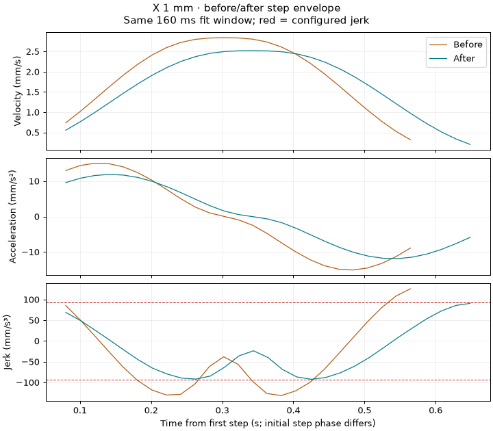

# E015 physical step-envelope comparison

Baseline: edge-next d2f5f44a (diagnostic e9f0ecd6 has identical firmware). Fix: 470e2f1f. Bench 2, M1 step/dir ch6/ch7, 12 MS/s, no ICE halt. Both sweeps: 10/10 diagnostic cases passed. Geometry: 1280 steps/mm; F600; xjm20 = 92.5926 mm/s³.

| X mm | Window ms | Baseline J/limit | Fixed J/limit | Baseline pulse span s | Fixed pulse span s |
|---:|---:|---:|---:|---:|---:|
| 0.01 | — | unresolved | unresolved | 0.0784 | 0.1315 |
| 0.02 | 80 | 1.373 | 0.947 | 0.1527 | 0.1780 |
| 0.05 | 80 | 1.414 | 0.999 | 0.2526 | 0.2402 |
| 0.1 | 80 | 1.431 | 1.004 | 0.2776 | 0.3138 |
| 0.25 | 120 | 1.445 | 0.992 | 0.3913 | 0.4416 |
| 0.5 | 120 | 1.438 | 1.007 | 0.5029 | 0.5683 |
| 1 | 160 | 1.422 | 0.998 | 0.6445 | 0.7286 |
| 2 | 240 | 1.430 | 0.998 | 0.8251 | 0.9380 |
| 5 | 240 | 1.441 | 0.985 | 1.1349 | 1.2843 |
| 10 | 240 | 1.442 | 1.000 | 1.5896 | 1.6629 |

Raw interval derivatives, peak v/a/j and all window estimates are retained in the run artifacts. The table uses the same windows selected from baseline sensitivity checks, not windows chosen to make the fixed results pass. Fits are degree-five position polynomials with at least 12 edges and 80% window coverage.

Calibration covers 8 initial step fractions × 4 DDA clock phases at both nominal jerk and 1.443× jerk. At nominal jerk the selected-window estimates span approximately 0.973–1.038 over 0.05–10 mm. The 0.02 mm estimator is biased low (0.938–0.983 nominal synthetic range); 0.01 mm is unresolved. This empirical check does not bound arbitrary model bias: executor segmentation and step correction are not simulated. The conservative one-step error bound is too large to certify an unconditional jerk limit. The observed reduction is strong evidence for the formula correction, not a claim of mechanical jerk or universal timing certification.

Pulse span is first-to-last rising edge, not command-to-rest time. Initial/final step phase affects short moves (including the apparently shorter fixed 0.05 mm span). Ideal quintic command-to-rest predictions are in baseline-fixed-comparison.json: correcting 1.443× jerk to 1× increases triangular-move duration by about 13%; the 10 mm feed-limited prediction increases about 8%. Those predictions are not measured endpoint timestamps.

Code review and board regression are separate gates. No merge is claimed.

Planner CPU trade-off: in the AVR simulator dense ramp_pnp full-lookahead calls average 10.8 ms (max 14.4 ms), versus baseline 3.28 ms (max 3.38 ms). The fixed trajectory satisfies the checked invariants; the baseline does not, so its shorter job time is not an equivalent compliant trajectory. These are CPU-model results, not XMEGA ISR measurements. Full records: E015-evidence/duration-aware-470e2f1f/avr-cost-comparison.json.

## Stored captures and overlays

- [Baseline summary](e9f0ecd6a216-before/summary.json)
- [Fixed summary and calibration](470e2f1fc243-after/summary.json)

The firmware code at the fixed capture is 470e2f1f. Its later harness relocation
854d58b0 changes no production firmware. Feedhold remainders shorter than the
runtime minimum segment remain a separate limitation; these normal-move captures
do not certify arbitrary hold interleavings. Planner-throughput hardware checks
remain outstanding.

Only 0.05, 1 and 10 mm retain raw captures/edges/plots in git. Every length retains its summary; full raw sweeps remain at the source run paths with hashes in summary.json.
