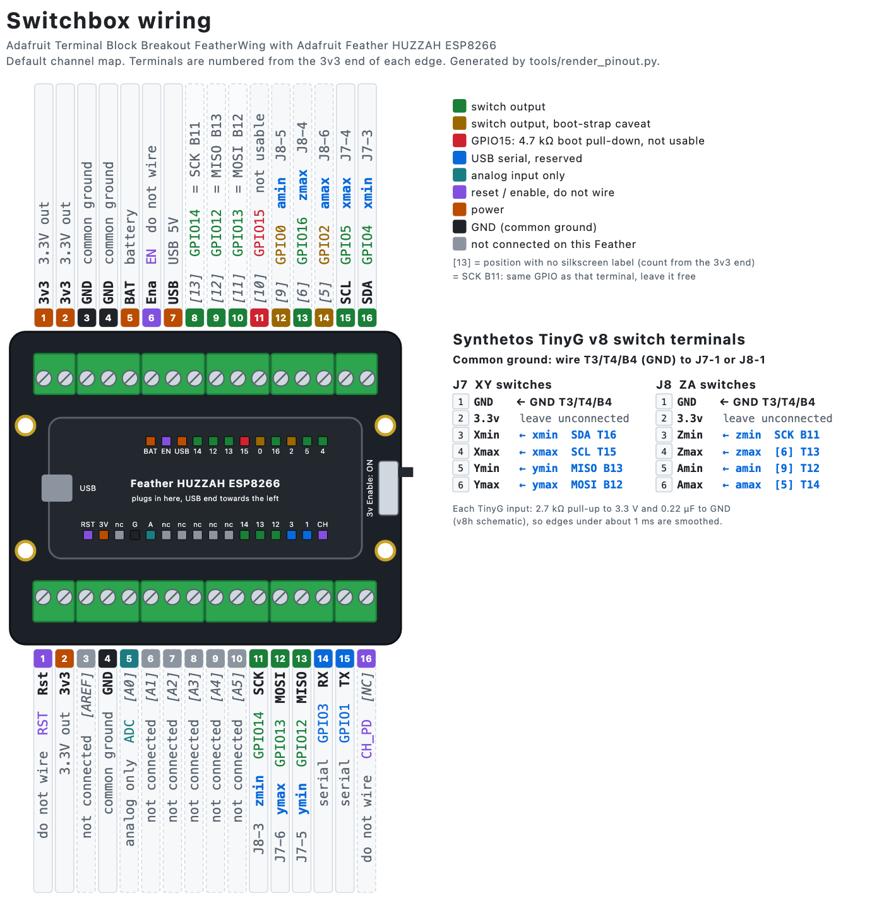
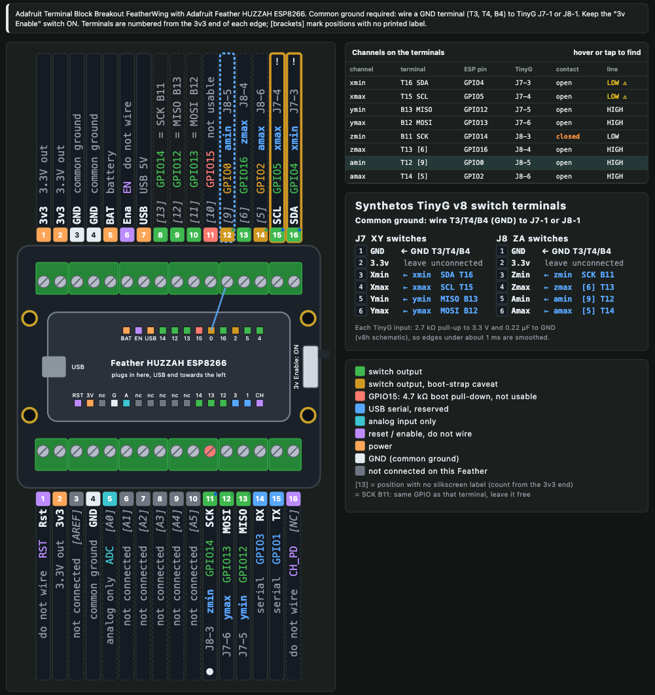
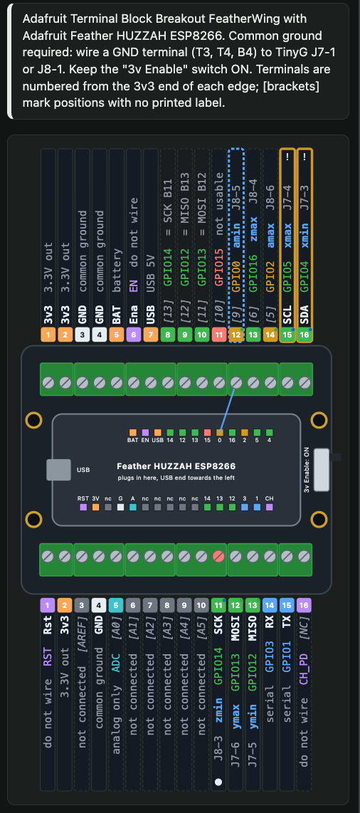

# TinyG HIL switchbox

An Adafruit Feather HUZZAH ESP8266, plugged into an Adafruit Terminal Block Breakout FeatherWing, whose screw terminals are wired to a TinyG v8's limit/homing switch inputs, so tests can open and close "switches" electrically, the way a real switch does. The TinyG's own edge detection, ISR, lockout, limit and homing logic run exactly as with a physical switch. Nothing on the TinyG side changes: no test-hooks build and no Atmel-ICE are needed.

| path | what |
|---|---|
| `openapi.json` | the API (OpenAPI 3.1). The single source of truth: the firmware embeds it, the Python client and the tests read it |
| `firmware/` | PlatformIO project (Arduino core for ESP8266) |
| `firmware/lib/sbcore/` | the core: request validation, channel model, edge sequencer, event ring. Plain C++, compiled on the host by `tests/host/test_switchbox_core.py` |
| `firmware/src/main.cpp` | ESP8266 layer: pins, timer, serial, WiFi, HTTP, WebSocket, LittleFS |
| `firmware/ui/index.html` | the web UI served at `/` |
| `boards/` | board profiles: the carrier (terminal-block FeatherWing), the Feather (HUZZAH ESP8266) and the target (TinyG v8), as data ([boards/README.md](boards/README.md)) |
| `tools/render_pinout.py` | the wiring drawings, from the profiles: docs images and the web UI's Wiring view |
| `docs/` | Adafruit design files (Eagle, Fritzing; CC BY-SA), source list, re-fetch script for the non-redistributable files, [pins.md](docs/pins.md) (which ESP8266 pins can be channels and why), the wiring guide and screenshots |
| `../tinyg_hil/switchbox.py` | Python client `SwitchBox` and a CLI |

## Wiring guide

<picture>
  <source media="(prefers-color-scheme: dark)" srcset="docs/wiring-dark.png">
  
</picture>

Vector versions: [docs/wiring.svg](docs/wiring.svg) (follows the viewer's light/dark theme) and [docs/wiring-dark.svg](docs/wiring-dark.svg). The full per-terminal table, with sources, is in [docs/wiring.md](docs/wiring.md). Regenerate after a profile change with `python3 tools/render_pinout.py`; a test fails if the committed images are stale.

**Reading the breakout:**
- The breakout's screw terminals are labelled with **Feather pin names, not ESP8266 GPIO numbers**, and **15 of the 32 carry no label at all** (A0-A5, AREF, 13-5 and the one past TX).
- Terminals are numbered from the 3v3 end of each edge (Micro-USB end of the Feather on the left):
  - T1-T16 along the edge that reads `3v3 3v3 GND GND BAT Ena USB … SCL SDA`;
  - B1-B16 along `Rst 3v3 … GND … SCK MOSI MISO RX TX`.
- On the HUZZAH ESP8266, "13" is GPIO14, "9" is GPIO0 and "SDA" is GPIO4.
- GPIO12/13/14 reach two terminals each. Use the labelled MISO/MOSI/SCK ones and leave 12/11/13 free.

| channel | terminal | breakout label | Feather pin | ESP pin | TinyG terminal |
|---|---|---|---|---|---|
| `xmin` | T16 | SDA | SDA | GPIO4 | J7-3 Xmin |
| `xmax` | T15 | SCL | SCL | GPIO5 | J7-4 Xmax |
| `ymin` | B13 | MISO | MISO | GPIO12 | J7-5 Ymin |
| `ymax` | B12 | MOSI | MOSI | GPIO13 | J7-6 Ymax |
| `zmin` | B11 | SCK | SCK | GPIO14 | J8-3 Zmin |
| `zmax` | T13 | (none) | 6 | GPIO16 | J8-4 Zmax |
| `amin` | T12 | (none) | 9 | GPIO0 (boot-strap) | J8-5 Amin |
| `amax` | T14 | (none) | 5 | GPIO2 (boot-strap) | J8-6 Amax |
| **GND** | **T3, T4 or B4** | GND | GND | GND | **J7-1 / J8-1 (required)** |

**Things that will bite:**
- Keep the breakout's **"3v Enable" slide switch ON**. OFF grounds the Feather's EN pin and switches the board off.
- Do not wire:
  - **B16** (unlabelled, past TX): the HUZZAH's chip enable (CH_PD); grounding it powers the ESP down;
  - **B1** (Rst);
  - **T11** ("10" = GPIO15).
- Leave the TinyG's 3.3v terminals (J7-2/J8-2) unconnected.

**In the web UI:**
- The **Wiring** tab draws the same breakout from the same profiles. Each terminal shows the live channel map, with the contact state, line level and wiring warnings overlaid.
- Hovering or tapping a terminal or a row of the channel table highlights its counterpart, and the terminal's trace to the Feather pin.
- `GET /api/board` (serial `getBoard`) returns the profiles and terminal map the firmware was built for.

| desktop | phone (390 px) |
|---|---|
|  |  |

The screenshots were taken on the board with nothing wired:
- xmin/xmax show the "open but line low" warning;
- zmin was tripped with a ttl;
- amin is highlighted.

## Electrical model

TinyG v8 switch inputs are xmega pins at 3.3 V with both-edge pin interrupts and the internal pull-up enabled (`firmware/tinyg/switch.c`). On the board, each line also has a **2.7 kΩ pull-up to 3.3 V and 0.22 µF to GND** at the terminal (v8h schematic, R10-R17 and C43-C50; see Limits and timing). A real switch shorts the input to GND; `$st` says whether TinyG reads it as normally open (0) or normally closed (1).

Each switchbox channel emulates an **open-drain contact** between one TinyG input and GND:

| contact | ESP8266 pin | TinyG line |
|---|---|---|
| `closed` | output, latch low | pulled to GND (reads 0) |
| `open` | input, high-Z, no pull-up | raised by TinyG's pull-up (reads 1) |

- The pin is **never driven high**. Only the output enable changes; the output latch is cleared before every enable. GPIO0-15 also have the pad's open-drain driver set, so a stray latch-high write could not source current either. GPIO16 has no open-drain mode and relies on the latch rule alone.
- At power-on, after any reset or crash, and after `releaseAll`, every pin is an input: **all contacts open, nothing driven.**
- **A common GND wire between the Feather and the TinyG is required.** Without it nothing works, and the readback is meaningless.
- Both sides are 3.3 V logic; no level shifting.
- If a real switch is also on an input, put the channel in parallel with a normally-open switch (wired-OR to GND). Disconnect NC switches; a closed NC switch holds the line low whatever the switchbox does.

### NO/NC semantics

Each channel has a configured type, `no` or `nc`, which should match the bench's `$st`. The API accepts either level:

| | NO channel | NC channel |
|---|---|---|
| `action: "trip"` | contact closed | contact open |
| `action: "release"` | contact open | contact closed |
| `state: "closed"/"open"` | the literal contact | the literal contact |
| `releaseAll` | open (untripped) | open (**tripped**) |
| `idleAll` | open | closed |

`releaseAll` is the electrical safe state: nothing driven. An NC limit then reads as tripped, just as a broken wire would. Use `idleAll` to un-trip every channel.

### Readback

Every reply and event carries the actual line levels read with `digitalRead`-equivalent register reads. A channel's `warning` (a warning, not an error) flags:

- closed but the line reads high: something else drives it high, or the pin or wire is faulty;
- open but the line reads low (more than 1 ms after it was released): a real switch or another device holds it low, a wiring fault, or TinyG is unpowered or disconnected and the input floats;
- open and the line toggles by itself: the input is floating (TinyG unpowered, or the wire is off).

The lines are also polled every 10 ms. A change on an undriven line (or a driven line reading high) becomes a `line` event, which shows TinyG power and wiring in the log. The rise of a line after its contact opens also shows up as a `line` event.

## Wiring and pins

Default mapping (configurable at runtime with `setConfig`, persisted in LittleFS):

| channel | GPIO | Feather pin | breakout terminal | TinyG input | notes |
|---|---|---|---|---|---|
| `xmin` | 4 | SDA | T16 SDA | J7-3 X min | |
| `xmax` | 5 | SCL | T15 SCL | J7-4 X max | |
| `ymin` | 12 | MISO (also "12") | B13 MISO | J7-5 Y min | |
| `ymax` | 13 | MOSI (also "11") | B12 MOSI | J7-6 Y max | |
| `zmin` | 14 | SCK (also "13") | B11 SCK | J8-3 Z min | |
| `zmax` | 16 | 6 | T13 (no label) | J8-4 Z max | GPIO16 has no pin interrupt (irrelevant here). Do not bridge 16 to RST for deep sleep: closing `zmax` would then reset the ESP |
| `amin` | 0 | 9 | T12 (no label) | J8-5 A min | **boot-strap pin**, see below |
| `amax` | 2 | 5 | T14 (no label) | J8-6 A max | **boot-strap pin**, see below |
| — | GND | GND | T3, T4 or B4 | J7-1 / J8-1 | **required** |

Channel names are free strings (1-15 of `A-Z a-z 0-9 _ - .`); tests use `<axis><min|max>`.

**Why only these 8 pins.** The Feather's headers carry 11 digital GPIOs: 0-5, 12-16 (from Adafruit's Rev G schematic; per-pin evidence and options for more channels are in [docs/pins.md](docs/pins.md)):
- 1 and 3 are the USB serial link;
- 15 cannot present an open contact;
- the other 8 are all in use;
- GPIO6-11 never leave the module.

The TinyG v8 has exactly 8 switch inputs, so 8 channels cover it one-to-one.

**Pins that are refused** (`setConfig` returns `invalid_config`):
- **GPIO15** must be low when the ESP8266 boots, so the Feather pulls it down with 4.7 kΩ (R7). Wired to a TinyG input, that pull-down and TinyG's pull-up form a divider:
  - with the v8's 2.7 kΩ board pull-up the open line sits near 2.2 V. That is neither a clean high for TinyG nor a low for the ESP's boot strap (input-low limit 0.83 V), so TinyG never sees a clean open contact and the ESP may fail to boot from flash.
  - It works through an N-MOSFET (docs/pins.md, option 1).
- GPIO1 and GPIO3 are the USB serial port: TX goes straight to the CP2104; RX is driven by the CP2104 through 1 kΩ.
- GPIO6-11 are the ESP-12 module's SPI flash and have no pad on the Feather.
- The ADC pin (A0) is analog-only (0-1.0 V).

**GPIO0 and GPIO2 are usable with caveats.** They must be high when the ESP8266 boots:
- GPIO2 has a 10 kΩ pull-up on the Feather;
- GPIO0 has only the red LED with 4.7 kΩ to 3.3 V;
- a powered TinyG's 2.7 kΩ pull-up keeps both high, and an open channel is high-Z, so normally they are fine.

But:
- a closed contact, or a real switch closed on that input, while the ESP resets stops it booting (GPIO0 low = UART download mode);
- LEDs: GPIO0 drives the Feather's red LED (D3), and GPIO2 the ESP-12 module's own blue LED. Both are lit while the contact is closed. The Feather's only push button (SW2) is RESET, not GPIO0;
- the CP2104 auto-reset circuit (transistor Q2) pulls GPIO0 low whenever DTR is asserted without RTS:
  - flashing the board does exactly that to enter the bootloader, and some serial tools do it on open/close;
  - TinyG then sees `amin` close;
  - do not flash the switchbox while TinyG is homing or running;
- **an unpowered TinyG holds them low.** Its 2.7 kΩ pull-ups then lead to a dead 3.3 V rail and overpower GPIO2's 10 kΩ pull-up and GPIO0's LED path (and both feed a little current into the TinyG). If the switchbox resets in that state, GPIO0 low puts it into the UART bootloader and GPIO2 low stops it booting. Power the TinyG first, or leave `amin`/`amax` unwired. This follows from the schematics and has not been tried on the bench.

Hence the default map uses them last, for the A axis.

**While the switchbox itself resets** (power-up, flashing, a crash; about 0.1-0.3 s until `setup()` runs), its pins are outside the firmware's control. They come up as inputs, but the ROM may drive some of them; GPIO2, for one, can carry UART1 boot output. Treat a switchbox reset like plugging switches in or out: the TinyG may see edges, most likely on `amin`/`amax`. Do not reset or flash it while the TinyG is homing or running.

## Build and flash

```
cd tests/hil/switchbox/firmware
pio run                                              # build
pio run -t upload --upload-port /dev/cu.usbserial-XXXX
```

- Everything is pinned in `platformio.ini`: platform `espressif8266@4.2.1`, Arduino core `3.30102.0` (3.1.2), `ArduinoJson@7.4.3`, `links2004/WebSockets@2.7.3`.
- The CP2104's DTR/RTS auto-reset puts the ESP8266 into its bootloader for the upload; no buttons needed.
- The spec and the UI are embedded at build time (`scripts/embed_assets.py` writes `src/generated/assets.h`, not committed).
- Find the port from USB descriptors, not by opening ports: the CP2104 is VID `0x10C4`, PID `0xEA60` (`ioreg -p IOUSB -l`, `system_profiler SPUSBDataType`). It appears as `/dev/cu.usbserial-<serial>` or `/dev/cu.SLAB_USBtoUART`. Never the TinyG bench ports.

### Why ESP8266WebServer + arduinoWebSockets, not ESPAsyncWebServer

Both the HTTP server (core's `ESP8266WebServer`) and the WebSocket server (`WebSockets4WebServer` from Links2004/arduinoWebSockets, on the same port 80 at `/ws`) are polled from `loop()`. So serial, HTTP and WebSocket requests all run in the same context, through one executor, serialized with no locks. Async handlers run in the lwIP callback context; they would need a cross-context queue and deferred replies, and AsyncWebSocket's per-client queue is a known heap hazard on the ESP8266's ~40 KB.

The cost is that a slow HTTP client can stall `loop()` briefly. Timed edges do not depend on `loop()`: they run from the timer1 interrupt. WebSocket pushes check each client's TCP buffer first and never block on a slow client.

## Provisioning WiFi

Credentials never go in source or git. Provision over USB serial:

```
cd tests/hil
uv run python -m tinyg_hil.switchbox wifi --port /dev/cu.usbserial-XXXX --ssid "ShopNet"   # prompts for the password
uv run python -m tinyg_hil.switchbox wifi --port /dev/cu.usbserial-XXXX --ssid "ShopNet" --password-stdin < pw.txt
uv run python -m tinyg_hil.switchbox wifi --port /dev/cu.usbserial-XXXX --ssid "shopnet" --password-stdin --match-ignore-case
uv run python -m tinyg_hil.switchbox scan-wifi --port /dev/cu.usbserial-XXXX [--show-names]
uv run python -m tinyg_hil.switchbox wifi --port /dev/cu.usbserial-XXXX --ssid ""          # forget them
```

- The credentials are stored in LittleFS (`/wifi.json`). They are never echoed, logged or returned by any op.
- The board reconnects about 300 ms after the reply.
- With no credentials, or if the station connection fails within 20 s, the board starts an access point:
  - SSID `tinyg-switchbox-XXXX` (last MAC bytes), password `tinyg-switchbox` (documented default);
  - the board is at `192.168.4.1`.
- mDNS name: `tinyg-switchbox.local`, in both modes.
- **When the station connection fails**, the board scans before falling back. `getInfo.wifi.last_failure` then reports:
  - the WiFi status at the timeout (e.g. `no_ssid_avail`, `wrong_password`);
  - whether the SSID was seen, and if so its channel, RSSI and encryption;
  - `similar_ssid_seen`: a network whose name differs only in case or surrounding spaces is in range. SSIDs are case-sensitive.

  The ESP8266 is 2.4 GHz-only and WPA2-only, so a 5 GHz-only or WPA3-only network never connects. No network names are reported beyond this flag.
- Station SSIDs and passwords are masked (`***`) in `SwitchBox.traffic` and in run records (`tinyg_hil.switchbox.redact`).
- `--match-ignore-case` has the board scan (`scanWifi`). It stores the one SSID equal to `--ssid` ignoring case and surrounding spaces, and refuses if none or several distinct SSIDs match. The exact name is never printed. `scan-wifi` lists what the board sees, with names masked unless `--show-names` is given.
- `getInfo` reports the WiFi mode, SSID, IP and RSSI.

**Security.** HTTP and the WebSocket have no authentication. Anyone on the same network, or anyone in range of the AP who knows the documented password, can trip the CNC's limit switches. Use station mode on a trusted network, or leave the board on USB only.

## API overview

One executor, three transports, the same operations. The `op` names are the spec's `operationId`s.

| op | REST | does |
|---|---|---|
| `getInfo` | `GET /api/info` | firmware/API version, spec SHA-256, uptime, boot id, heap, WiFi, mDNS |
| `getState` | `GET /api/state` | every channel: name, gpio, type, contact state, tripped, line level, last change, pending pulse/bounce, ttl, warning |
| `setChannel` | `PUT /api/channels/{name}` | `state: closed\|open` or `action: trip\|release`, optional `ttl_ms` |
| `pulseChannel` | `POST /api/channels/{name}/pulse` | `ms` or `us`, `action` (default trip) or `state`: timed on the board |
| `bounceChannel` | `POST /api/channels/{name}/bounce` | `edges`, `interval_us`, `final_state` or `final_action`, optional `ttl_ms` |
| `releaseAll` | `POST /api/release_all` | every contact open, all timers cancelled |
| `idleAll` | `POST /api/idle_all` | every channel untripped for its type |
| `getConfig` / `setConfig` | `GET/PUT /api/config` | mapping and types; validated as a whole, persisted; `{"defaults": true}` |
| `getEvents` | `GET /api/events?since=&limit=` | event history (pages of up to 32) |
| `setWifi` | `PUT /api/wifi` | station credentials |
| `scanWifi` | `GET /api/wifi/scan` | networks the board sees (blocks it ~2-4 s; refused while a connection attempt runs) |
| `getSpec` | `GET /openapi.json` | the spec; over serial, one line, so the API is learnable without WiFi |
| `getBoard` | `GET /api/board` | the board profiles the firmware was built for and the derived terminal map (Wiring guide) |
| `subscribe` | (serial only) | event lines on the serial connection |

**Serial** (115200 8N1): newline-delimited JSON.

```
> {"id":1,"op":"setChannel","name":"xmin","action":"trip","ttl_ms":2000}
< {"id":1,"ok":true,"result":{"changed":true,"ttl_ms":2000,"channel":{"name":"xmin","gpio":4,"type":"no","state":"closed",...}}}
> {"id":2,"op":"pulseChannel","name":"ymin","us":200}
> {"id":3,"op":"setChannel","name":"wmin","state":"closed"}
< {"id":3,"ok":false,"error":{"code":"unknown_channel","msg":"unknown channel 'wmin'"}}
```

- After a reset the board prints one `{"event":"boot",...}` line. The ESP8266 ROM first prints a banner at 74880 baud; clients skip lines that are not JSON objects.
- Event lines (`{"event":...}`) only come after `subscribe`.
- Opening the port must not reset the board. The CP2104's DTR/RTS drive the auto-reset transistors: RTS asserted alone resets the ESP8266, DTR asserted alone pulls GPIO0 low.
  - macOS asserts both when the port opens, and pyserial then applies DTR before RTS. Presetting both False (`dtr = rts = False` before `open()`) therefore leaves RTS asserted alone for an instant, and the board reset on 3 of 3 opens.
  - What works (0 resets on 3 opens and 3 closes, as did keeping both asserted): preset both True on the unopened `Serial()`, so `open()` changes nothing, then set `rts = False`, then `dtr = False`.
  - `SwitchBox` does this (`lines="release-after-open"`) and verifies it with `getInfo` (uptime against time since open, plus the boot line). The evidence is the diagnostic `tests/diagnostics/test_switchbox_reset_on_open.py`.
  - Dropping RTS first briefly leaves DTR asserted alone, which pulls GPIO0 (`amin`) low for that instant. The 10 ms line poll did not catch it; a scope or Saleae would be needed to measure it.
  - `pio device monitor` and other terminals may still reset the board when they open the port.

**REST**: `curl -X PUT -H 'Content-Type: application/json' -d '{"action":"trip","ttl_ms":500}' http://tinyg-switchbox.local/api/channels/xmin`. The response body is the op's result, or `{"error":{"code","msg"}}` with 400/404/409/500.

**WebSocket** `/ws`:
- On connect: a snapshot (info, config, state), then the last 16 events.
- Then every event is pushed live: commands from any source, edges, line changes.
- Clients send requests in the serial framing.
- Pushes are throttled: at most 6 per client per 20 ms, only while the client's TCP buffer has room. A client more than 24 events behind skips ahead and gets `{"event":"dropped","count":N}` plus a fresh state.

**Web UI** at `/` (no external resources, so it works on the isolated AP):
- a Wiring tab: the breakout drawn from the board profiles with the live channel map and state (Wiring guide);
- channel grid: contact, tripped/released, line level, warnings;
- click a channel to toggle it, or use its Pulse button;
- Release all / Idle all;
- a live log of every command and edge with source, request id, µs timestamp and result;
- the mapping editor;
- a connection indicator.

**Events.** Each event has:
- `seq` (monotonic);
- `t_us` (64-bit µs since boot, `micros64()`, so no 71-minute wrap);
- `src`: `serial`, `http`, `ws`, `ttl`, `poll`, `boot` or `sys`;
- `rid`: the request id, when it was a positive integer;
- kind-specific fields;
- `levels` and `driven`: one character per channel, in config order.

What gets logged:
- Every state change.
- Every command that changes something or fails.
- Successful read-only queries (`get*`) are **not** logged, so polling cannot push real history out of the 128-entry ring.
- An edge's `levels` are sampled right at the edge, before a released line has risen. The following `line` event shows the rise.

**ttl.** `setChannel`/`bounceChannel` with `ttl_ms` open the contact by themselves after that long (source `ttl`), even if the test process died. The ttl is a hard limit: it also ends a running pulse or bounce. A later `setChannel` replaces it.

**Errors.** Unknown ops, channels and parameters are rejected with structured errors (`unknown_op`, `unknown_channel`, `unknown_param`, ...). Numeric parameters out of range are clamped and listed in the result's `clamped` array. Negative, fractional and wrongly typed values are rejected.

## Using it from tests

```
uv run pytest tests/test_switchbox.py --switchbox --switchbox-port /dev/cu.usbserial-XXXX \
    --runs-dir .analysis/hil-runs
```

- `--switchbox` un-skips `@pytest.mark.switchbox` tests.
- The port comes from, in order:
  - `--switchbox-port` (or `TINYG_SWITCHBOX_PORT`);
  - the `switchbox` entry of `--port`'s bench in the bench file;
  - for a run without `--port`, the bench file's top-level `switchbox` entry.

  The bench file is `tinyg_hil.benches`: `$TINYG_BENCHES` or `~/.config/tinyg-hil/benches.json`, kept outside the repository. The tracked `config/benches.json` is only an example with placeholders. The port is never guessed.
- The client refuses TinyG bench ports and `never_open` ports.
- The `switchbox` fixture:
  - releases every contact and idles every channel before the test, and releases after;
  - records the test's switchbox traffic and board events in the run record;
  - its session fixture holds the board lock for the switchbox's port and records the board's identity in `run.json` (`instruments.switchbox`).
- `close/open/pulse/release_all` have the `SoftSwitches` meaning (close = trip for the channel's type), so a test written against the ICE `switches` fixture can take `switchbox` instead. Make the channel types match `$st`.

## Limits and timing

- **Never time edges from the host.**
  - A serial command costs about 87 µs per byte at 115200 (a typical request plus reply is 10-40 ms on the wire), plus USB-serial latency of 1-16 ms each way.
  - `pulseChannel` and `bounceChannel` time both edges on the board.
- **On-board timing:**
  - Edges closer than 50 µs (short pulses, fast bounces) are timed by spinning on the µs clock with interrupts masked: about ±1 µs. Interrupts stay masked for the whole sequence, at most 64 × 50 µs = 3.2 ms.
  - Longer gaps use the timer1 interrupt (0.2 µs ticks). Entry latency is a few µs; WiFi can delay it by tens of µs now and then. Bounce edges are scheduled on absolute times, so latency does not accumulate.
  - Every edge's actual timestamp is in the event log, so a test can check the widths it got.
  - These are the board's own timestamps. Any timing claim about what TinyG saw still needs a Saleae capture on the TinyG input (bench 2 has X min on ch0). Until then it is timing-pending.
- **What the TinyG actually sees:** every v8 switch input has a 2.7 kΩ pull-up and 0.22 µF to GND (v8h schematic).
  - When a contact opens, the line rises with τ ≈ 0.6 ms and reaches the input-high threshold about 0.7-0.8 ms later.
  - When it closes, the ESP pin discharges the capacitor in a few µs.
  - So a 20 µs pulse reaches the xmega as a low lasting roughly 0.7 ms, and bounce edges much under a millisecond apart merge into fewer edges.
  - The board's µs timing is what it drives, not what the TinyG samples.
  - The ESP's own readback is on the same node, so its "open but line low" warning waits 5 ms after a release.
- **Inrush:** closing a contact dumps the 0.22 µF charge through the ESP pin, a short peak well above the 12 mA rating, just as a mechanical switch would. A 100 Ω series resistor per channel limits it to about 33 mA and still gives a solid low (≈ 0.12 V). This is a recommendation from the schematics, not bench-tested.
- **Line watch:** polled every 10 ms; shorter external glitches are not seen.
- **Event ring:** 128 events. `getEvents` returns at most 32 per page; `lost` says how many were overwritten.
- **Ranges:** 8 channels; `ttl_ms` ≤ 1 h; pulses ≤ 60 s (`ms`) or ≤ 1 s (`us`); bounces ≤ 64 edges, 2 µs-100 ms apart.
- **Heap:** about 40 KB of usable heap. Large content (spec ~26 KB, UI) is served from flash in chunks. `getSpec` is not available over the WebSocket.

## Possible later feature: "mount" (not implemented)

Emulate a switch fixed at a machine position, without the Atmel-ICE: count the TinyG's step/dir pulses for one motor on two input GPIOs, and trip a channel when the count crosses a set position. The API has room for it: a `mountChannel` op is reserved in the spec's `x-future`, and channels already carry a type and state that a mount would drive through the same sequencer.

The ESP8266 constrains it:
- **No hardware pulse counter** (the ESP32 has PCNT). Every step edge would be a GPIO interrupt. The core's dispatch costs roughly 2-4 µs at 160 MHz, which puts the ceiling around 100-200 kHz of edges in theory.
- **WiFi masks interrupts** for tens of µs at a time (longer during association and scans), so steps are missed well below that ceiling. TinyG steps at up to about 50 kHz per motor.
- Realistic use: homing-speed step rates of a few kHz, with WiFi off.
- For full-speed moves: an ESP32 (PCNT), or the existing test-hooks mount in TinyG itself (`switches.mount` with `--ice`).

## Tests

| test | needs | covers |
|---|---|---|
| `tests/host/test_switchbox_core.py` | `c++`, ArduinoJson (pinned; from `.pio/libdeps` or fetched by `pio`) | the core under ASan/UBSan with faked pins, clock and timer |
| `tests/hil/tests/test_switchbox_offline.py` | nothing | client framing, reset check, ports, the spec ↔ client parity, the firmware's embedded spec |
| `tests/hil/tests/test_switchbox_boards_offline.py` | nothing | board profiles (the carrier regenerates from the Eagle files, the Feather profile is complete and cited), terminal map, unsafe-pin flags, renderer determinism, docs up to date, every terminal drawn, no label collisions |
| `tests/hil/tests/test_switchbox.py` | the Feather on USB, `--switchbox` | the real board: readback, ttl, pulses, bounce, config validation, errors, events |
| `tests/hil/tests/test_switchbox_network.py` | the board in station mode, `--switchbox` | mDNS, REST (same executor as serial, structured errors), `/openapi.json`, the UI page, WebSocket snapshot/requests/live events |
| `tests/hil/tests/diagnostics/test_switchbox_reset_on_open.py` | `--switchbox --diagnostics` | which DTR/RTS handling opens the port without resetting the board |
